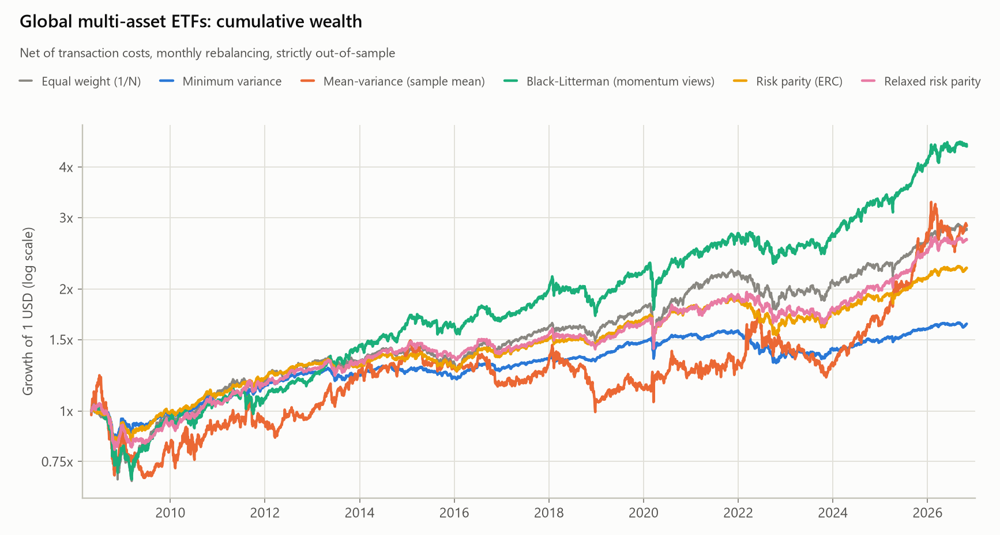
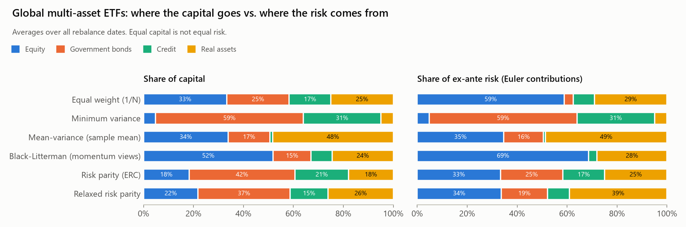
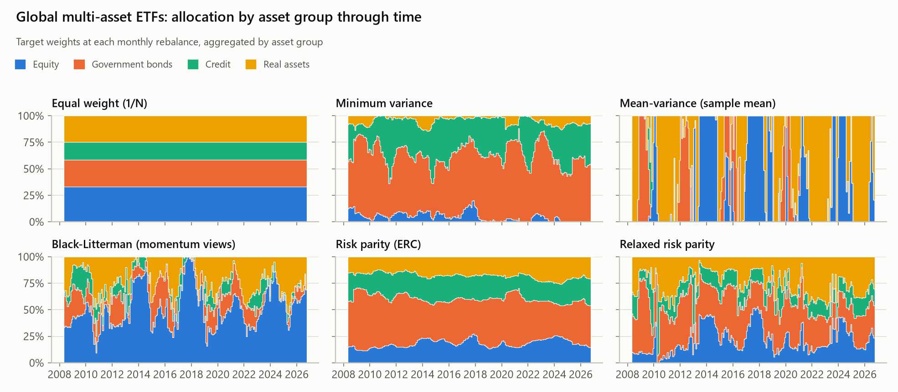
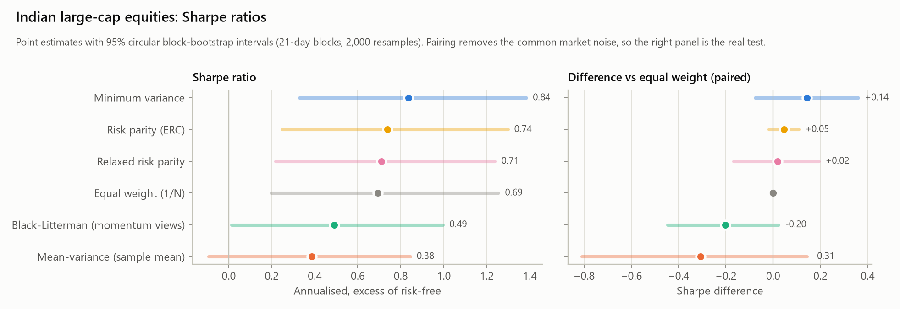
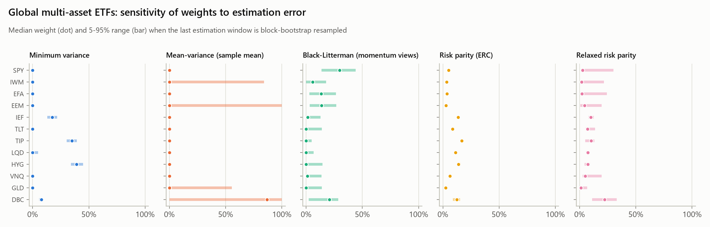
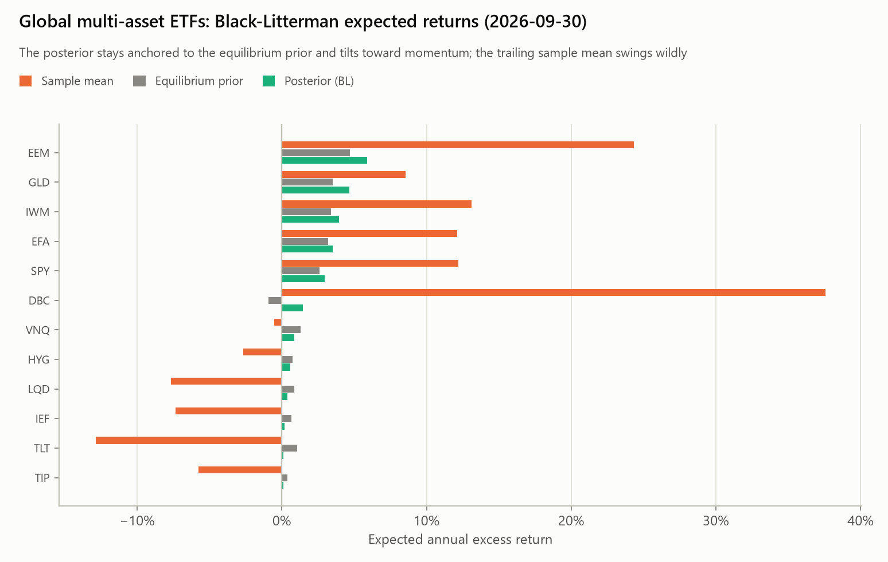
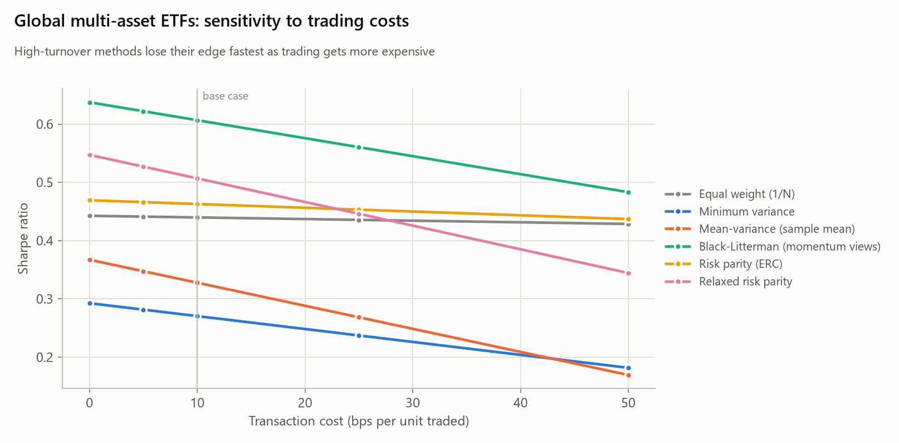

# Portfolio Construction Lab

**How much of "optimal" portfolio construction survives contact with estimation error, trading costs and an honest out-of-sample test?**

This project compares six portfolio construction methods: 1/N, minimum variance,
Markowitz mean–variance, Black–Litterman, risk parity (ERC) and relaxed risk parity.
They run in a single walk-forward backtest with monthly rebalancing, transaction costs
and block-bootstrap inference, on two very different universes:

| Universe | Assets | Out-of-sample period | Character |
|---|---|---|---|
| **Global multi-asset** | 12 ETFs: equities, Treasuries, credit, real assets | May 2008 – Oct 2026 | Volatilities differ ~5×; low or negative cross-asset correlations |
| **Indian large caps** | 20 NSE stocks across 6 sectors | Feb 2011 – Oct 2026 | One asset class; high, homogeneous correlations |

All optimisers are written from first principles (cvxpy and NumPy), unit-tested against
closed-form results, and driven by YAML configs. One command reproduces every number and figure below.



---

## Key findings

1. **Markowitz with sample means is an estimation-error maximiser.** In both universes it
   has the worst risk-adjusted return: Sharpe 0.33 and 0.38, vs 0.44 and 0.69 for 1/N. It also
   trades more than 3.6× its capital per year and averages 78–85% in a single asset. When the *same* year
   of data is block-resampled, its weights move 39–50% one-way.
2. **Risk parity delivers exactly what it promises, cheaply.** It equalises ex-ante risk
   (the effective number of risk contributors equals N). After 1/N it has the lowest turnover (23–36% p.a.)
   and it is by far the most robust to estimation error (weights move only 3–4%). It matches or slightly beats
   1/N (ΔSharpe +0.02 and +0.05). In the multi-asset universe it also cuts the maximum drawdown from
   −34.5% to −19.5%.
3. **Black–Litterman fixes the *inputs*; the *views* decide the outcome.** Cross-asset
   momentum views gave the best multi-asset Sharpe (0.61, ΔSharpe +0.17 vs 1/N, one-sided
   p = 0.05). The identical view model *hurt* among Indian large caps (0.49, ΔSharpe −0.20).
   The Bayesian machinery kept weights diversified in both cases; it cannot rescue a signal
   that does not work in a given market.
4. **There is no universal winner.** Minimum variance is the *worst* multi-asset
   strategy (Sharpe 0.27): it holds about 90% bonds and credit through the 2022 rate shock. It is the *best*
   Indian-equity strategy (Sharpe 0.84), consistent with the low-volatility anomaly.
5. **Most differences are not statistically distinguishable from 1/N.** Even 16–18 years of
   daily data leave 95% Sharpe intervals about ±0.5 wide. Only the *paired* bootstrap, which
   removes common market noise, gets close to separating strategies. This is the
   central lesson of DeMiguel, Garlappi & Uppal (2009), reproduced here.

## Results

### Global multi-asset ETFs (USD, 10 bps costs)

| Strategy | CAGR | Vol | Sharpe | Max DD | Turnover p.a. | Eff. N (risk) | ΔSharpe vs 1/N [95% CI] |
|:---|---:|---:|---:|---:|---:|---:|:---|
| Equal weight (1/N) | 5.7% | 10.9% | 0.44 | −34.5% | 15% | 8.1 | - |
| Minimum variance | 2.7% | 5.4% | 0.27 | −17.0% | 60% | 3.5 | −0.17 [−0.47, 0.12] |
| Mean-variance (sample mean) | 5.9% | 18.3% | 0.33 | −44.1% | 362% | 1.3 | −0.11 [−0.61, 0.35] |
| Black-Litterman (momentum views) | **8.5%** | 12.4% | **0.61** | −34.7% | 191% | 3.3 | **+0.17 [−0.03, 0.35]** |
| Risk parity (ERC) | 4.5% | 7.1% | 0.46 | −19.5% | 23% | **12.0** | +0.02 [−0.17, 0.22] |
| Relaxed risk parity | 5.4% | 8.4% | 0.51 | −23.2% | 169% | 4.4 | +0.07 [−0.23, 0.32] |



Equal capital is not equal risk. 1/N puts a third of its capital in equities, yet equities
drive 59% of its risk. ERC rebalances the *risk* budget evenly by holding about 42% in Treasuries.



### Indian large-cap equities (INR, 15 bps costs)

| Strategy | CAGR | Vol | Sharpe | Max DD | Turnover p.a. | Eff. N (risk) | ΔSharpe vs 1/N [95% CI] |
|:---|---:|---:|---:|---:|---:|---:|:---|
| Equal weight (1/N) | 17.0% | 15.3% | 0.69 | −33.4% | 29% | 18.3 | - |
| Minimum variance | **18.2%** | **13.6%** | **0.84** | **−27.5%** | 113% | 9.8 | **+0.14 [−0.08, 0.36]** |
| Mean-variance (sample mean) | 13.5% | 23.8% | 0.38 | −40.3% | 368% | 1.5 | −0.31 [−0.81, 0.14] |
| Black-Litterman (momentum views) | 13.8% | 16.3% | 0.49 | −32.8% | 225% | 6.6 | −0.20 [−0.45, 0.02] |
| Risk parity (ERC) | 17.3% | 14.5% | 0.74 | −31.9% | 36% | **20.0** | +0.05 [−0.02, 0.11] |
| Relaxed risk parity | 17.1% | 14.9% | 0.71 | −30.4% | 126% | 8.3 | +0.02 [−0.17, 0.19] |



The left panel shows why "strategy A has a higher Sharpe" is weak evidence on its own:
every interval overlaps. In the right panel the paired differences are much tighter. ERC's edge over 1/N
is small but consistent ([−0.02, 0.11]); sample-mean Markowitz is the clear laggard.

### Estimation error: the root cause

The final one-year estimation window is block-bootstrapped 300 times. Each resample is a
plausible alternative history from the same process. Every input and every portfolio is re-estimated
on each one:



| Average one-way distance from the median portfolio | Global multi-asset | Indian equities |
|:---|---:|---:|
| Mean-variance (sample mean) | 39% | 50% |
| Black-Litterman | 24% | 32% |
| Relaxed risk parity | 19% | 15% |
| Minimum variance | 4% | 19% |
| Risk parity (ERC) | **3%** | **4%** |

Methods that consume $\hat\mu$ inherit its enormous standard error: for a 20%-vol asset,
one year of data pins the mean down only to about ±20% p.a. Methods that use only
$\hat\Sigma$ are an order of magnitude more stable. Black–Litterman sits in between:



The trailing sample mean says commodities will return +37% a year and long Treasuries −13%.
The posterior stays anchored to the equilibrium prior and only *tilts* toward the momentum
signal.

### Robustness

- **Covariance estimator.** Ledoit–Wolf shrinkage lifts minimum variance from Sharpe 0.17
  (sample covariance) to 0.27 and cuts its turnover from 82% to 60% in the multi-asset universe.
  Risk parity barely notices the estimator. EWMA covariances respond faster but raise turnover
  for every optimised method (full tables in each `REPORT.md`).
- **Trading costs.** Raising costs from 10 to 50 bps leaves 1/N and ERC almost unchanged.
  Mean–variance and relaxed risk parity lose 0.15–0.20 of Sharpe.



Full auto-generated reports, with every table and figure, are in
[`results/global_multi_asset/REPORT.md`](results/global_multi_asset/REPORT.md) and
[`results/india_equities/REPORT.md`](results/india_equities/REPORT.md).

## Methods

| Method | Objective | Uses μ? | Implementation |
|:---|:---|:---:|:---|
| Equal weight | $w_i = 1/N$ | no | - |
| Minimum variance | $\min_w w^\top\Sigma w$ | no | QP (cvxpy / Clarabel) |
| Mean–variance | $\max_w \hat\mu^\top w - \tfrac{\delta}{2} w^\top\Sigma w$ | sample mean | QP |
| Black–Litterman | Mean–variance on the posterior $(\mu_{BL}, \Sigma_{BL})$; prior $\pi=\delta\Sigma w_m$; momentum views via Grinold's rule | posterior | closed-form posterior + QP |
| Risk parity (ERC) | $w_i(\Sigma w)_i$ equal for all $i$ | no | Spinu's convex reformulation, damped Newton |
| Relaxed risk parity | ERC relaxed toward a return target (Gambeta & Kwon, 2020) | sample mean | SOCP with rotated cones |

**Backtest protocol.** Monthly rebalancing on the last trading day. Every estimate uses the
trailing 252 days *up to and including* the rebalance date, and trades execute at that close.
Weights drift with prices between rebalances, and costs are charged on the actual traded
notional. Long-only and fully invested, with no position caps, so each method shows its natural behaviour.
All strategies share one set of estimates per date, so the comparison isolates the
construction rule.

**Inference.** A circular block bootstrap (21-day blocks, 2,000 draws) gives Sharpe
intervals. The draws are paired across strategies to test differences against 1/N.

The full specification, equations and a list of implementation pitfalls are in
[`docs/methodology.md`](docs/methodology.md).

## Engineering

- **Config-driven.** A universe, its strategies and its experiments are one YAML file
  ([`configs/`](configs)); adding a universe needs no code.
- **Reproducible.** Prices are downloaded once and cached in parquet, every random draw is
  seeded, and `portfolio-lab run` regenerates all tables, figures and reports.
- **Tested.** 66 tests on synthetic data cover: ERC equalising risk contributions in any units;
  reverse optimisation recovering the market portfolio; certain views being matched exactly;
  relaxed risk parity collapsing to ERC; weight-drift and cost accounting checked by hand; and
  two *look-ahead* tests. One of those rewrites the future and checks that no past decision
  changes.
- **Data hygiene.** Vendor back-filled prices are detected and masked. Example: NESTLEIND.NS
  shows a constant price throughout 2009, followed by a fake +76% "return".
- **Robust numerics.** Solver fallbacks, a dispersion guard on signal z-scores, and graceful
  degradation when a relaxed risk parity return target is infeasible. There were zero solver failures across both
  universes.

```
portfolio-construction-lab/
├── configs/                  # one YAML per universe/experiment
├── src/portfolio_lab/
│   ├── data.py               # download, cache, cleaning, risk-free, market weights
│   ├── estimators.py         # sample / Ledoit-Wolf / EWMA covariance, momentum
│   ├── black_litterman.py    # prior, views, posterior
│   ├── optimizers.py         # min-var, mean-var, ERC (Newton), relaxed RP (SOCP)
│   ├── strategies.py         # estimates -> target weights
│   ├── backtest.py           # walk-forward engine with drift and costs
│   ├── metrics.py            # performance, diversification, block bootstrap
│   ├── plotting.py           # one consistent visual system
│   ├── experiments.py        # the research pipeline
│   └── cli.py                # `portfolio-lab run ...`
├── tests/                    # synthetic-data unit tests (no network)
├── results/<universe>/       # REPORT.md, CSV tables, figures/
└── docs/methodology.md       # equations, protocol, pitfalls, references
```

## Reproduce

```bash
python -m venv .venv
source .venv/bin/activate            # Windows: .venv\Scripts\activate
pip install -e ".[dev]"

pytest                               # ~1 min, offline
portfolio-lab run configs/global_multi_asset.yaml configs/india_equities.yaml
```

The first run downloads data from Yahoo Finance into `data/` (not committed). A full run
takes about 5 minutes per universe on a laptop.

## Limitations

- **Survivorship bias (Indian equities).** The universe is *today's* large caps, which inflates
  absolute returns for every strategy. Relative comparisons are less affected but not immune.
- **Market weights are approximations.** Indian caps hold today's share count fixed; the ETF
  prior is an illustrative global market portfolio. Both only affect the Black–Litterman prior.
- **Costs are linear.** There is no market impact, borrow or tax modelling. Indian costs (15 bps) include
  securities transaction tax only roughly.
- **Untuned hyper-parameters.** δ = 2.5, τ = 0.05, IC = 0.10, κ = 0.25 and the 252-day window are standard
  textbook values. They were fixed *before* looking at results to avoid backtest overfitting;
  a parameter-sensitivity study is the natural next step.
- **Unlevered risk parity.** Practitioners usually lever ERC to a volatility target. Sharpe
  ratios are leverage-invariant; CAGR is not.
- **Multiple comparisons.** Five strategies are tested against one benchmark, and the p-values are not adjusted.

## References

Black & Litterman (1992) · DeMiguel, Garlappi & Uppal (2009) · Gambeta & Kwon (2020) ·
He & Litterman (1999) · Ledoit & Wolf (2004) · Maillard, Roncalli & Teïletche (2010) ·
Michaud (1989) · Politis & Romano (1992) · Spinu (2013). Full citations are in
[`docs/methodology.md`](docs/methodology.md#references).

## License

MIT. See [LICENSE](LICENSE).
