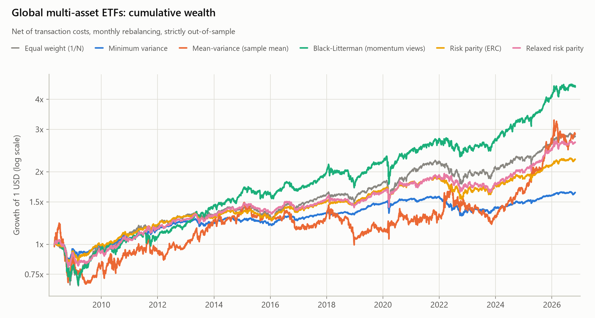
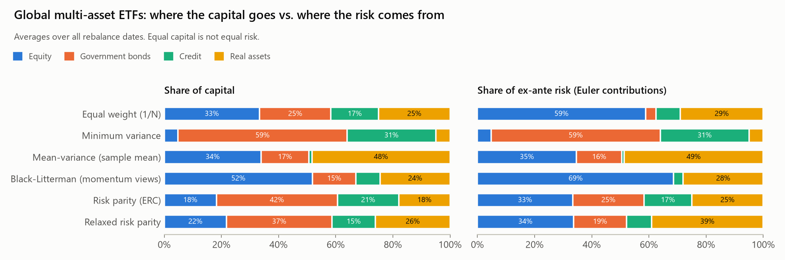
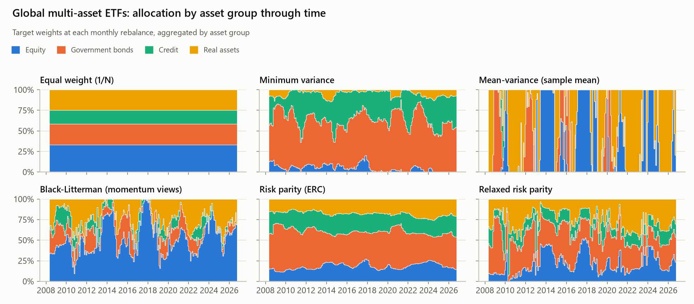
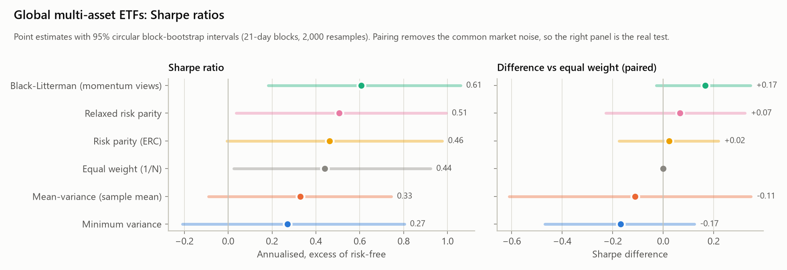
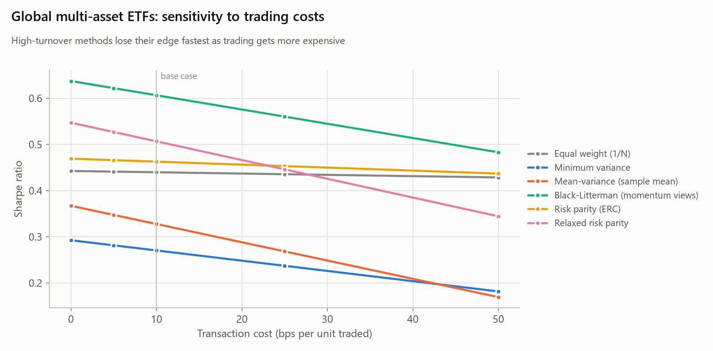
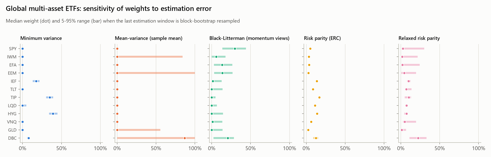
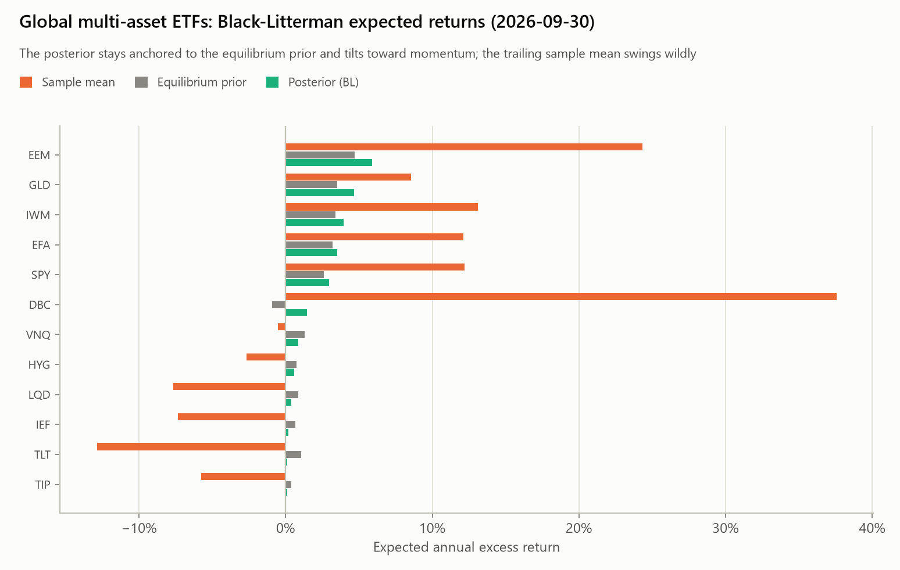
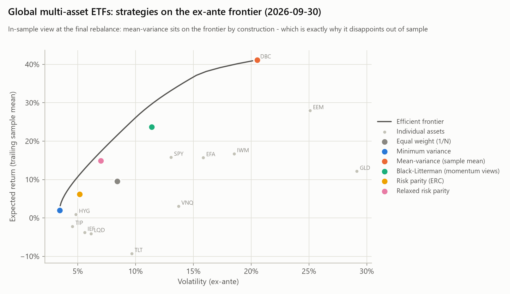
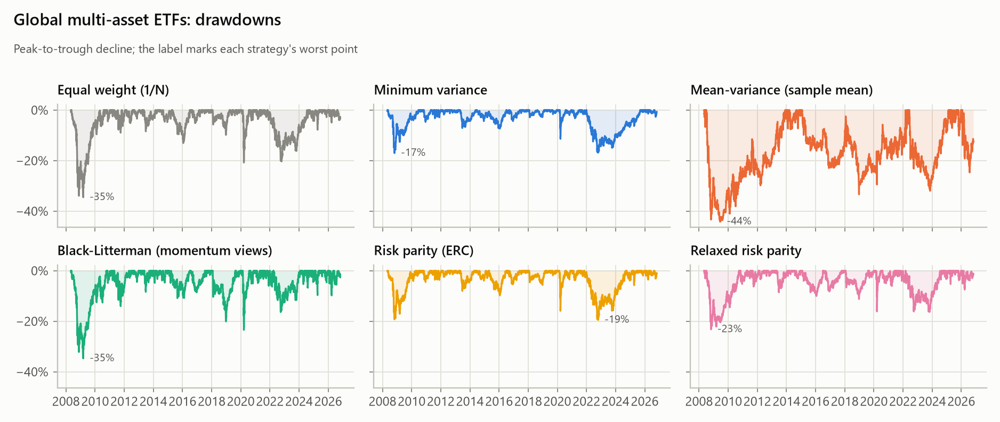

# Global multi-asset ETFs - results

_Auto-generated by `portfolio-lab run configs/global_multi_asset.yaml`._

* Out-of-sample period: **2008-05-01 -> 2026-10-30** (4,655 trading days, 222 monthly rebalances)
* Estimation window: 252 trading days; covariance: `ledoit_wolf`
* Transaction costs: 10 bps per unit traded; currency: USD

## Performance (net of costs)

|  | CAGR | Volatility | Sharpe | Sortino | Max drawdown | Calmar |
|:---|---:|---:|---:|---:|---:|---:|
| Equal weight (1/N) | 5.7% | 10.9% | 0.44 | 0.62 | -34.5% | 0.17 |
| Minimum variance | 2.7% | 5.4% | 0.27 | 0.38 | -17.0% | 0.16 |
| Mean-variance (sample mean) | 5.9% | 18.3% | 0.33 | 0.45 | -44.1% | 0.13 |
| Black-Litterman (momentum views) | 8.5% | 12.4% | 0.61 | 0.84 | -34.7% | 0.24 |
| Risk parity (ERC) | 4.5% | 7.1% | 0.46 | 0.65 | -19.5% | 0.23 |
| Relaxed risk parity | 5.4% | 8.4% | 0.51 | 0.70 | -23.2% | 0.23 |

## Portfolio structure (averages over rebalances)

|  | Turnover (1-way, p.a.) | Effective N (weights) | Effective N (risk) | Avg max weight | Diversification ratio |
|:---|---:|---:|---:|---:|---:|
| Equal weight (1/N) | 15.2% | 12.00 | 8.05 | 8.3% | 1.65 |
| Minimum variance | 59.6% | 3.54 | 3.54 | 39.6% | 1.73 |
| Mean-variance (sample mean) | 362.1% | 1.39 | 1.29 | 84.5% | 1.14 |
| Black-Litterman (momentum views) | 190.5% | 4.53 | 3.25 | 34.1% | 1.45 |
| Risk parity (ERC) | 22.9% | 9.15 | 12.00 | 18.0% | 1.97 |
| Relaxed risk parity | 169.0% | 6.57 | 4.37 | 29.3% | 1.86 |

## Is the difference real? Block-bootstrap Sharpe inference vs 1/N

|  | Sharpe | Sharpe CI low | Sharpe CI high | dSharpe vs benchmark | dSharpe CI low | dSharpe CI high | p (dSharpe <= 0) |
|:---|---:|---:|---:|---:|---:|---:|---:|
| Equal weight (1/N) | 0.44 | 0.03 | 0.92 | 0.00 | - | - | - |
| Minimum variance | 0.27 | -0.21 | 0.80 | -0.17 | -0.47 | 0.12 | 0.87 |
| Mean-variance (sample mean) | 0.33 | -0.09 | 0.74 | -0.11 | -0.61 | 0.35 | 0.69 |
| Black-Litterman (momentum views) | 0.61 | 0.18 | 1.06 | 0.17 | -0.03 | 0.35 | 0.05 |
| Risk parity (ERC) | 0.46 | -0.01 | 0.98 | 0.02 | -0.17 | 0.22 | 0.43 |
| Relaxed risk parity | 0.51 | 0.04 | 0.99 | 0.07 | -0.23 | 0.32 | 0.33 |

## Covariance estimator ablation

Sharpe ratio:

|  | sample | ledoit_wolf | ewma |
|:---|---:|---:|---:|
| Equal weight (1/N) | 0.44 | 0.44 | 0.44 |
| Minimum variance | 0.17 | 0.27 | 0.18 |
| Mean-variance (sample mean) | 0.33 | 0.33 | 0.38 |
| Black-Litterman (momentum views) | 0.60 | 0.61 | 0.59 |
| Risk parity (ERC) | 0.45 | 0.46 | 0.49 |
| Relaxed risk parity | 0.51 | 0.51 | 0.54 |

One-way annual turnover:

|  | sample | ledoit_wolf | ewma |
|:---|---:|---:|---:|
| Equal weight (1/N) | 15.2% | 15.2% | 15.2% |
| Minimum variance | 82.4% | 59.6% | 116.5% |
| Mean-variance (sample mean) | 364.8% | 362.1% | 373.1% |
| Black-Litterman (momentum views) | 206.4% | 190.5% | 216.6% |
| Risk parity (ERC) | 24.4% | 22.9% | 32.1% |
| Relaxed risk parity | 179.3% | 169.0% | 186.6% |

## Transaction-cost sensitivity (Sharpe)

|  | 0 bps | 5 bps | 10 bps | 25 bps | 50 bps |
|:---|---:|---:|---:|---:|---:|
| Equal weight (1/N) | 0.44 | 0.44 | 0.44 | 0.44 | 0.43 |
| Minimum variance | 0.29 | 0.28 | 0.27 | 0.24 | 0.18 |
| Mean-variance (sample mean) | 0.37 | 0.35 | 0.33 | 0.27 | 0.17 |
| Black-Litterman (momentum views) | 0.64 | 0.62 | 0.61 | 0.56 | 0.48 |
| Risk parity (ERC) | 0.47 | 0.47 | 0.46 | 0.45 | 0.44 |
| Relaxed risk parity | 0.55 | 0.53 | 0.51 | 0.45 | 0.34 |

## Estimation-error sensitivity (final window, resampled)

|  | Avg weight std | Avg distance to median (1-way) | Avg max weight |
|:---|---:|---:|---:|
| Equal weight (1/N) | 0.0% | 0.0% | 8.3% |
| Minimum variance | 1.0% | 4.4% | 39.9% |
| Mean-variance (sample mean) | 12.3% | 39.3% | 89.8% |
| Black-Litterman (momentum views) | 5.6% | 23.8% | 31.5% |
| Risk parity (ERC) | 0.6% | 3.0% | 16.8% |
| Relaxed risk parity | 4.8% | 19.2% | 26.0% |

## Black-Litterman anatomy and the efficient frontier

