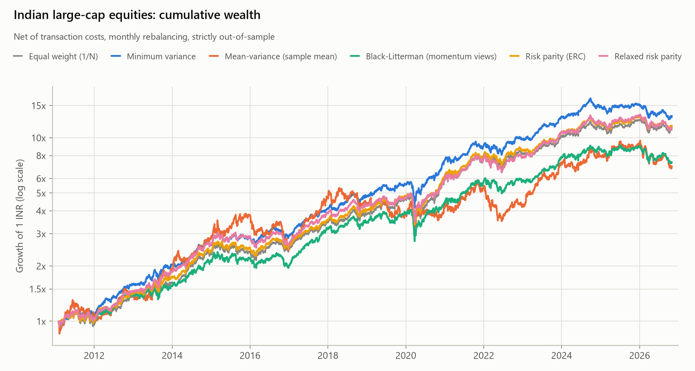
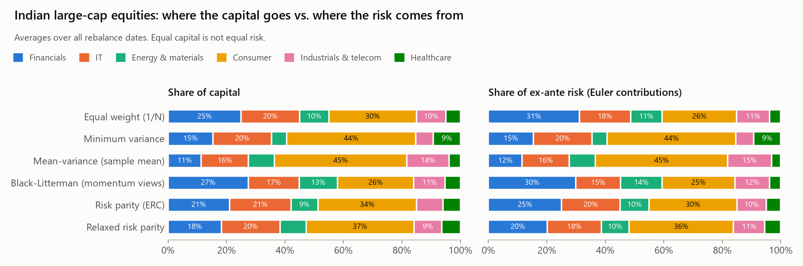
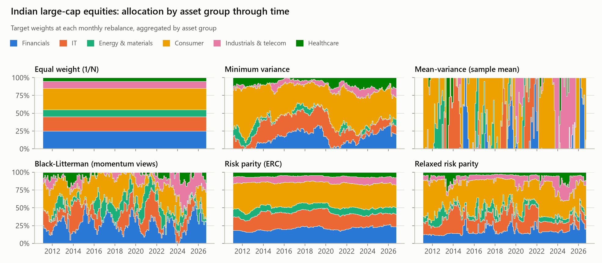
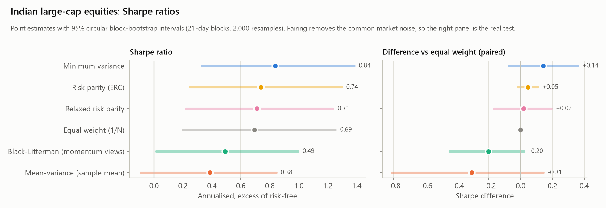
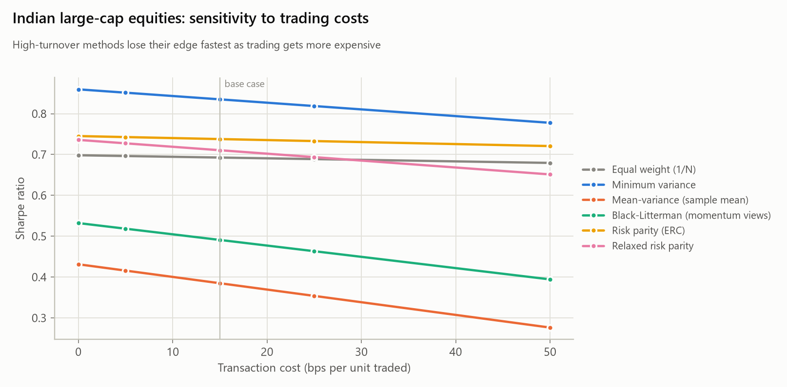
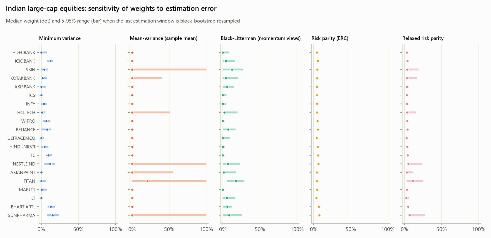
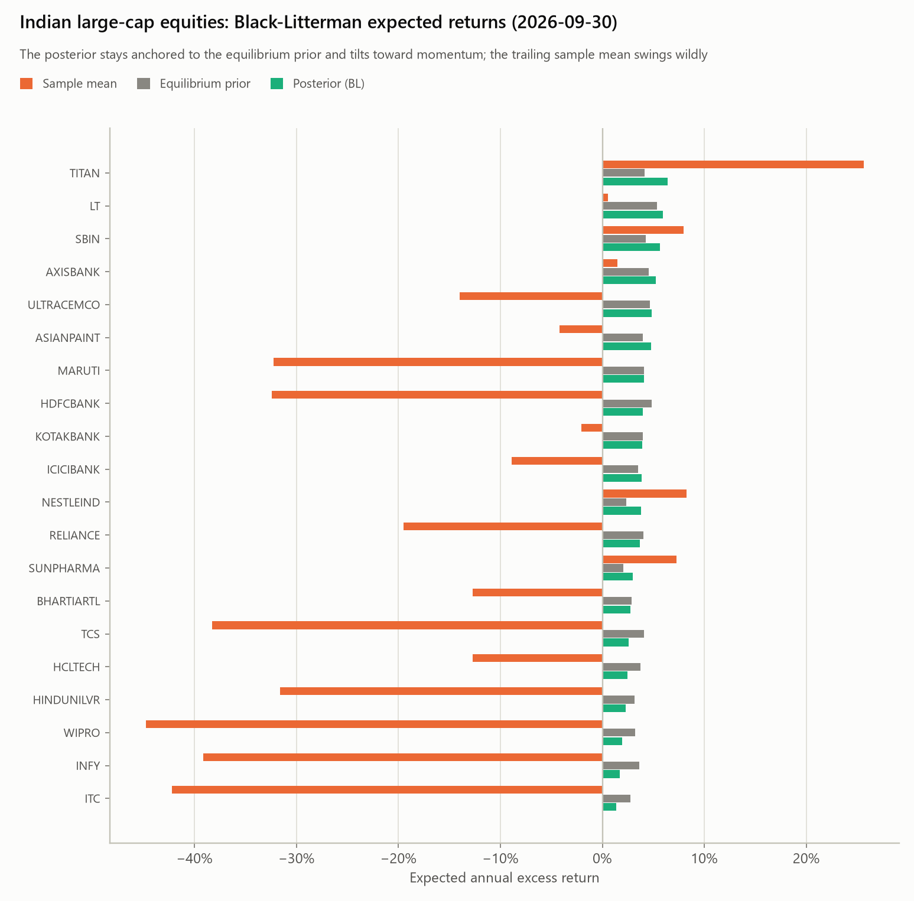
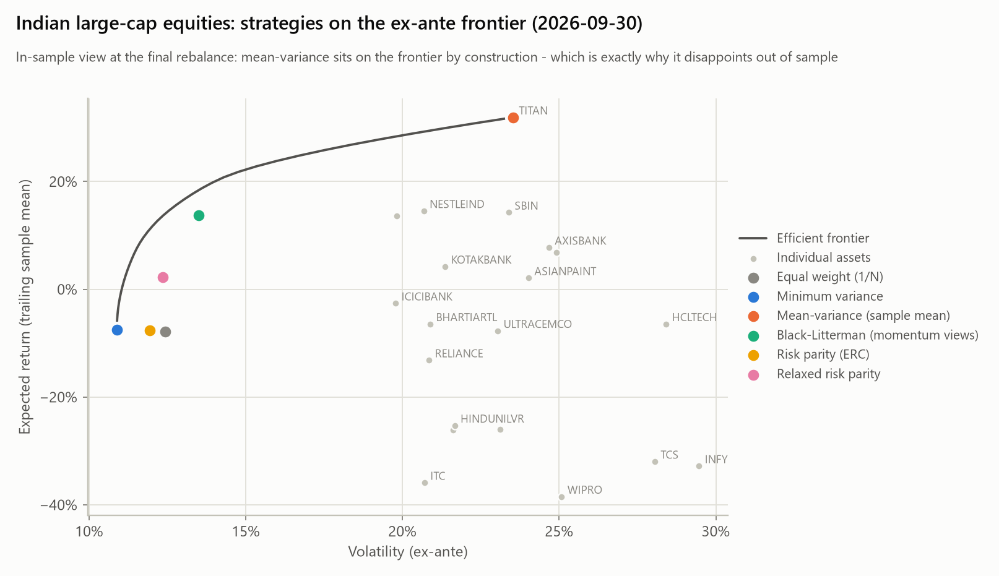
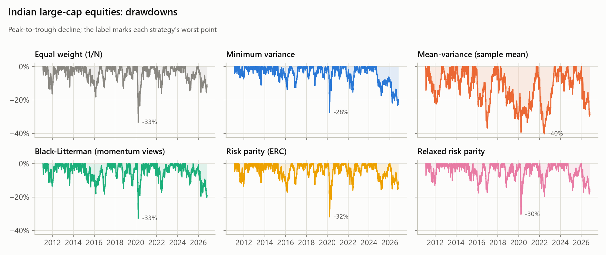

# Indian large-cap equities - results

_Auto-generated by `portfolio-lab run configs/india_equities.yaml`._

* Out-of-sample period: **2011-02-01 -> 2026-10-30** (3,884 trading days, 189 monthly rebalances)
* Estimation window: 252 trading days; covariance: `ledoit_wolf`
* Transaction costs: 15 bps per unit traded; currency: INR

## Performance (net of costs)

|  | CAGR | Volatility | Sharpe | Sortino | Max drawdown | Calmar |
|:---|---:|---:|---:|---:|---:|---:|
| Equal weight (1/N) | 17.0% | 15.3% | 0.69 | 0.98 | -33.4% | 0.51 |
| Minimum variance | 18.2% | 13.6% | 0.84 | 1.21 | -27.5% | 0.66 |
| Mean-variance (sample mean) | 13.5% | 23.8% | 0.38 | 0.56 | -40.3% | 0.33 |
| Black-Litterman (momentum views) | 13.8% | 16.3% | 0.49 | 0.69 | -32.8% | 0.42 |
| Risk parity (ERC) | 17.3% | 14.5% | 0.74 | 1.05 | -31.9% | 0.54 |
| Relaxed risk parity | 17.1% | 14.9% | 0.71 | 1.01 | -30.4% | 0.56 |

## Portfolio structure (averages over rebalances)

|  | Turnover (1-way, p.a.) | Effective N (weights) | Effective N (risk) | Avg max weight | Diversification ratio |
|:---|---:|---:|---:|---:|---:|
| Equal weight (1/N) | 28.9% | 20.00 | 18.26 | 5.0% | 1.95 |
| Minimum variance | 112.7% | 9.81 | 9.81 | 17.6% | 2.07 |
| Mean-variance (sample mean) | 367.9% | 1.62 | 1.45 | 77.7% | 1.17 |
| Black-Litterman (momentum views) | 224.6% | 7.84 | 6.62 | 21.5% | 1.72 |
| Risk parity (ERC) | 35.8% | 18.88 | 20.00 | 7.6% | 2.03 |
| Relaxed risk parity | 126.0% | 11.15 | 8.34 | 21.5% | 1.93 |

## Is the difference real? Block-bootstrap Sharpe inference vs 1/N

|  | Sharpe | Sharpe CI low | Sharpe CI high | dSharpe vs benchmark | dSharpe CI low | dSharpe CI high | p (dSharpe <= 0) |
|:---|---:|---:|---:|---:|---:|---:|---:|
| Equal weight (1/N) | 0.69 | 0.20 | 1.25 | 0.00 | - | - | - |
| Minimum variance | 0.84 | 0.33 | 1.38 | 0.14 | -0.08 | 0.36 | 0.11 |
| Mean-variance (sample mean) | 0.38 | -0.09 | 0.84 | -0.31 | -0.81 | 0.14 | 0.90 |
| Black-Litterman (momentum views) | 0.49 | 0.01 | 1.00 | -0.20 | -0.45 | 0.02 | 0.96 |
| Risk parity (ERC) | 0.74 | 0.25 | 1.30 | 0.05 | -0.02 | 0.11 | 0.08 |
| Relaxed risk parity | 0.71 | 0.22 | 1.24 | 0.02 | -0.17 | 0.19 | 0.42 |

## Covariance estimator ablation

Sharpe ratio:

|  | sample | ledoit_wolf | ewma |
|:---|---:|---:|---:|
| Equal weight (1/N) | 0.69 | 0.69 | 0.69 |
| Minimum variance | 0.84 | 0.84 | 0.89 |
| Mean-variance (sample mean) | 0.39 | 0.38 | 0.39 |
| Black-Litterman (momentum views) | 0.49 | 0.49 | 0.49 |
| Risk parity (ERC) | 0.74 | 0.74 | 0.74 |
| Relaxed risk parity | 0.72 | 0.71 | 0.72 |

One-way annual turnover:

|  | sample | ledoit_wolf | ewma |
|:---|---:|---:|---:|
| Equal weight (1/N) | 28.9% | 28.9% | 28.9% |
| Minimum variance | 124.8% | 112.7% | 197.3% |
| Mean-variance (sample mean) | 370.6% | 367.9% | 375.1% |
| Black-Litterman (momentum views) | 228.5% | 224.6% | 234.5% |
| Risk parity (ERC) | 36.6% | 35.8% | 48.3% |
| Relaxed risk parity | 129.6% | 126.0% | 144.0% |

## Transaction-cost sensitivity (Sharpe)

|  | 0 bps | 5 bps | 15 bps | 25 bps | 50 bps |
|:---|---:|---:|---:|---:|---:|
| Equal weight (1/N) | 0.70 | 0.70 | 0.69 | 0.69 | 0.68 |
| Minimum variance | 0.86 | 0.85 | 0.84 | 0.82 | 0.78 |
| Mean-variance (sample mean) | 0.43 | 0.42 | 0.38 | 0.35 | 0.28 |
| Black-Litterman (momentum views) | 0.53 | 0.52 | 0.49 | 0.46 | 0.39 |
| Risk parity (ERC) | 0.75 | 0.74 | 0.74 | 0.73 | 0.72 |
| Relaxed risk parity | 0.74 | 0.73 | 0.71 | 0.69 | 0.65 |

## Estimation-error sensitivity (final window, resampled)

|  | Avg weight std | Avg distance to median (1-way) | Avg max weight |
|:---|---:|---:|---:|
| Equal weight (1/N) | 0.0% | 0.0% | 5.0% |
| Minimum variance | 2.6% | 18.5% | 17.4% |
| Mean-variance (sample mean) | 10.8% | 49.5% | 84.9% |
| Black-Litterman (momentum views) | 4.4% | 32.4% | 23.2% |
| Risk parity (ERC) | 0.5% | 3.8% | 7.8% |
| Relaxed risk parity | 2.5% | 15.2% | 21.1% |

## Black-Litterman anatomy and the efficient frontier

